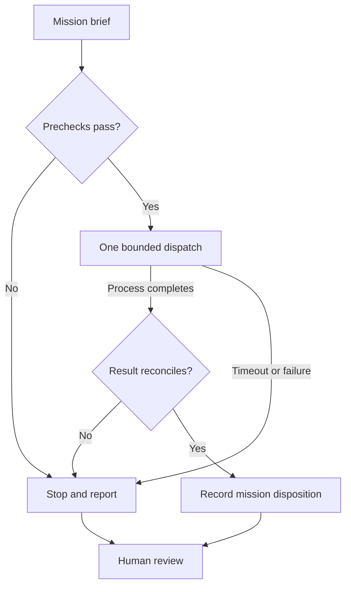

# FORGE Core — Execution, readiness, and human authority

## Engineering problem

A completed process can still leave its mission blocked. FORGE Core separates
those outcomes through one brief, one bounded WHITE RABBIT execution, and one
reconciliation record. All inputs are synthetic.

## Architecture



The brief identifies the scenario, mission, site, executor, limits, and requested
end state. Prechecks verify the executor hash and snapshot permitted inputs.
Reconciliation checks returned identities, input receipts, counts, references,
requirement coverage, and disposition against the source records. Snapshots are
checked again afterward. JSON and Markdown outputs preserve the three outcome states.

## Decisions that matter

| Control | Operational purpose |
| --- | --- |
| One named executor and allowlisted fixture scenarios | Keep the proof of concept's scope explicit |
| Fixed executor hash | Detect a runtime differing from the accepted baseline |
| One dispatch and a five-second timeout | Bound execution and prevent automatic retry loops |
| Input snapshots and evidence-reference checks | Expose changed inputs and unsupported results |
| Separate execution, reconciliation, and mission states | Preserve a valid blocked or conflicted outcome |
| Human decision always PENDING_ACTUAL | Keep consequential decisions outside automated disposition |
| Standard-library Python and offline fixtures | Make behavior locally reproducible without service setup |

## Observed behavior on the operator's Mac

Python 3.8.5 passed 15 unittest methods, including all five WHITE RABBIT fixture
outcomes and failure controls. Two local walkthroughs supplied concrete evidence:

| Outcome | Recovery mission | Missing-evidence mission |
| --- | --- | --- |
| Execution | COMPLETED | COMPLETED |
| Reconciliation | ACCEPTED | ACCEPTED |
| Mission | READY_FOR_REVIEW | BLOCKED |
| Requested end state met | True | False |
| Human decision | PENDING_ACTUAL | PENDING_ACTUAL |
| Dispatch attempts | 1 | 1 |

In the blocked walkthrough, power and access were SATISFIED while connectivity
was MISSING. The coordinator accepted the executor's accurate report and kept
the mission blocked. This is the central result: successful processing can
correctly return an unmet mission objective.

Evidence: operator-supplied terminal output, October 31, 2026. The tests also
exercise forged results, changed inputs, identity mismatch, process errors,
malformed output, and a simulated timeout.

## Human and AI roles

The operator set the objective, approved scope, and ran validation. AI assisted
architecture, code, tests, and documentation. The runtime is deterministic Python;
no autonomous AI agent or conversation handoff is implemented. Human review is
represented by a pending decision. Approval collection and subsequent execution
are outside this version.

## Boundaries

Real field conditions, evidence freshness, and source authority are outside scope.
The child timeout is not an end-to-end guarantee; output size is checked after
capture. Hashes identify bytes, not authenticity. No production security,
productivity improvement, or real deployment readiness is established.

## Reproduce and inspect

From the standalone repository root:

```bash
python3 -B -m unittest discover -s forge_core/tests -v
python3 -B forge_core/core.py
```

The default command runs the recovery mission. Results appear in a new ignored
`forge_core/.runs/nexus-.../` directory. Inspect `SITREP.md` and
`nexus_record.json` together.

- [FORGE Core contract and limits](README.md)
- [Validation record](VALIDATION.md)
- [Default mission brief](briefs/readiness.json)
- [WHITE RABBIT executor](../README.md)

Status: standalone public candidate. The observed Mac runs used the original
private layout; see [validation](VALIDATION.md) for the adapted layout's status.
`PENDING_ACTUAL` denotes the pending human decision. No real deployment is authorized.
